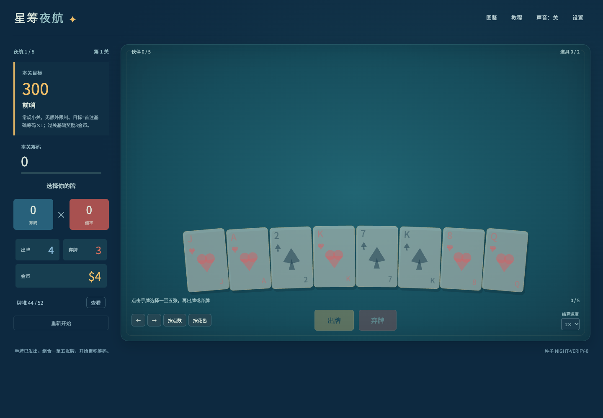
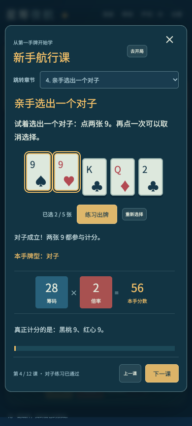

# 星筹夜航 · GPT 6.1 制作小游戏测试

用一副纸牌，找到自己的航线。组合牌型，让筹码与倍率增长，带着奇妙伙伴穿过八段夜航。

**[下载游戏](https://github.com/Linwei-Chen/gpt-game-night-voyage/releases/tag/v0.1.0) · [三分钟入门](docs/PLAYING.md) · [制作实验记录](docs/EXPERIMENT.md)**

[](https://github.com/Linwei-Chen/gpt-game-night-voyage/actions/workflows/check.yml)



这是一次“GPT 6.1 制作小游戏测试”，由 GPT / Codex 协作完成浏览器游戏。游戏采用原创夜航主题、卡面、名称和声音，规则与数值有独立的事实记录。当前版本为可玩实验版。

## 直接开始玩

从 **[下载版本](https://github.com/Linwei-Chen/gpt-game-night-voyage/releases/tag/v0.1.0)** 获取 `night-voyage-v0.1.0-web.zip`，解压后按包内 `START_HERE.txt` 启动本地游戏。也可按下方“本地运行”从源码启动。第一次进入会出现12章“新手航行课”。建议先练第四课“亲手选出一个对子”，再点“去开局”、选择最低难度并开始航行。手机和电脑均可游玩；随时点顶部“教程”复习。

每手选1～5张牌，组成对子、两对、顺子、同花等牌型。得分是最终筹码乘最终倍率，累加到本关总分。在出牌次数耗尽前达到目标就过关；缺关键牌时，用弃牌换牌。过关后去商店买伙伴、升级牌型和改造纸牌，再去下一关。

- **做出你的组合：**150名伙伴、12种牌型、15种起始牌组、8档难度。
- **边玩边学习：**选牌练习、逐步计分、伙伴顺序对比与利息滑块。
- **建立自己的牌组：**道具、凭单、印记、强化、版本与卡包。
- **继续挑战：**完成八段后获胜，也能继续同一局的更远航程。
- **适合反复尝试：**种子重现、自动存档、保存恢复、速度与减少运动设置。

存档保存在当前浏览器。同一种子、牌组、难度与操作可重现本游戏的一局；换浏览器或清除网站数据会影响本地存档。设置中可以导出存档。

## 想做第一局挑战？

先用最低难度通关第一段，试着用一个常出的牌型建立伙伴组合。觉得有趣，欢迎给仓库点个Star，分享你的种子、牌组、伙伴组合和最终成绩；也可在 [玩家讨论](https://github.com/Linwei-Chen/gpt-game-night-voyage/discussions) 交流玩法；遇到问题请用 [反馈模板](https://github.com/Linwei-Chen/gpt-game-night-voyage/issues/new/choose) 记录操作和截图。



## 本地运行

下载网页成品并解压后，在解压目录运行 `python3 -m http.server 8080 --bind 127.0.0.1`，再打开 <http://127.0.0.1:8080/>。Windows已安装Python时可将 `python3` 换成 `python`。

从源码运行需要Node.js 22或兼容版本。

```sh
git clone https://github.com/Linwei-Chen/gpt-game-night-voyage.git
cd gpt-game-night-voyage
npm ci
npm run dev
```

打开终端显示的网址。构建生产版使用 `npm run build`，预览使用 `npm run preview`。

## 制作与验证

采用TypeScript、PixiJS与Vite，逻辑与画面分离。计分使用事件队列，伙伴效果使用声明式注册器，随机序列可复现。完整实验过程、测试范围和观察结果见 [实验记录](docs/EXPERIMENT.md)。

```sh
npm test
npm run audit
npm run verify:facts
npm run verify:run
```

既有统一测试1,967项通过，包含行为场景和同源字段一致性检查；还有手算计分、24关正常实战、203步保存恢复重放、桌面/手机教程与独立评审。详细范围见 [验证报告](docs/verification-report.md)、[覆盖看板](docs/coverage.md) 和 [事实表](docs/fact-table.md)。自动检查会重新执行测试、构建、重放和项目子路径浏览器验证。

当前开放完整内容目录；持久解锁、挑战、成就尚未实现，完整无尽及原版整局/逐帧对照尚未验收。已有规则参考Balatro并做独立实现，最终1:1原版验收仍以验证报告中的缺口为准。

## 贡献与许可

欢迎完善玩法说明、改进手机操作、补充边界测试或分享有趣的种子。见 [贡献说明](CONTRIBUTING.md)。项目独立编写的代码与原创内容采用 [MIT许可](LICENSE)；Noto字体及其子集按OFL使用，依赖的许可见 [第三方记录](THIRD_PARTY_NOTICES.md)。

**English:** Night Voyage is a playable browser card strategy game and a GPT 6.1 game development experiment. Download and play locally, learn with the in-game tutorial, and share your seed and strategy. The interface and tutorial are in Chinese.
